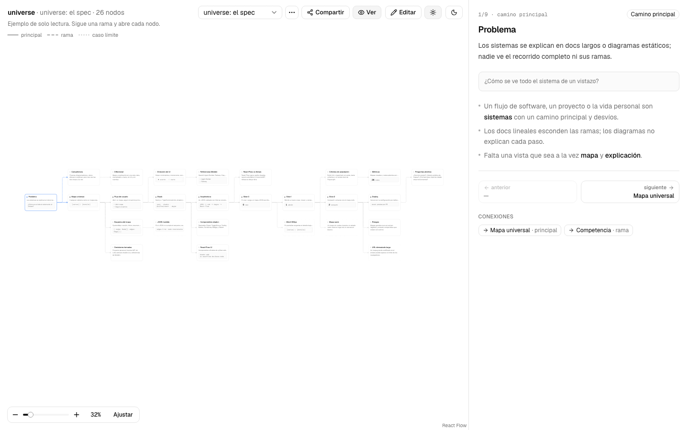
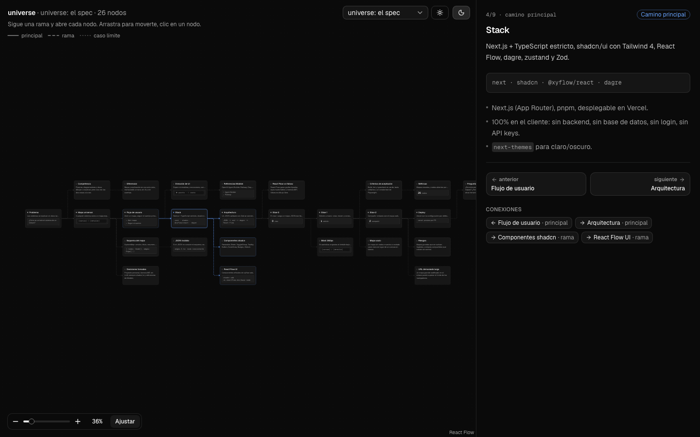
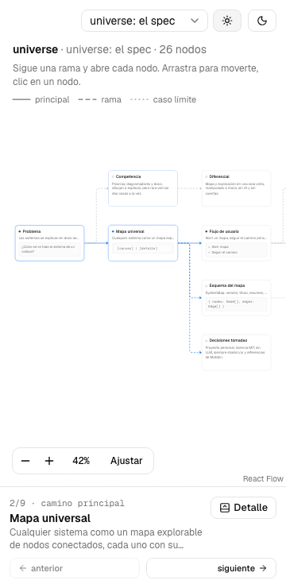

# universe

Mapas universales de sistemas: un canvas minimalista de nodos conectados, cada uno con su explicación.

Mapea cualquier sistema (flujos de software, proyectos, vida personal) como un mapa explorable. A la izquierda, un canvas infinito con mini tarjetas conectadas por flechas: el camino principal va de izquierda a derecha y las ramas (errores, casos límite) salen hacia arriba y abajo. A la derecha, el detalle del nodo seleccionado: posición en el camino, explicación, detalles, anterior/siguiente y conexiones.

Sin IA, sin backend, sin login: todo corre en el navegador.



| Oscuro | Móvil (360px) |
| --- | --- |
|  |  |

## Desarrollo

```bash
pnpm install
pnpm dev          # http://localhost:3000
pnpm build        # build de producción
pnpm lint
pnpm typecheck    # tsc --noEmit
pnpm test         # vitest: esquema, layout y navegación
pnpm exec playwright install chromium   # una vez
pnpm build && pnpm test:e2e   # playwright smoke test (usa el build de producción)
UPDATE_SCREENSHOTS=1 pnpm test:e2e   # regenera docs/screenshots (sin la variable, van a test-results/)
```

Teclado: Tab recorre "Saltar al detalle", el selector de mapa y el tema, y luego los nodos del canvas (con anillo de foco); Enter o Espacio abren el nodo en el detalle.

Stack: Next.js (App Router) + TypeScript estricto, shadcn/ui + Tailwind 4, `next-themes`, `@xyflow/react` + React Flow UI, dagre, zustand y Zod.

## Esquema `SystemMap`

Un mapa es un JSON que cualquiera puede escribir a mano (o generar). Se valida con Zod en [`src/lib/schema.ts`](src/lib/schema.ts).

```ts
type SystemMap = {
  version: 1;
  title: string;
  summary: string;
  nodes: Node[];
  edges: Edge[];
};

type Node = {
  id: string;                 // único dentro del mapa; se recortan espacios y no puede quedar vacío
  title: string;
  summary: string;            // una línea, máximo 140 caracteres
  details?: string;           // por defecto ""; markdown simple: párrafos, listas "-", **negrita**, *cursiva*, `código`
  preview?: {                 // mini vista previa en la tarjeta y el panel
    type: "text" | "list" | "code" | "metric" | "ui";
    content: string;          // list/ui: una línea por elemento; metric: "<valor> <unidad>"
  };
  position?: { x: number; y: number }; // opcional: fija la posición y omite el layout automático
  track: "main" | "branch";   // main = camino principal; branch = ramas y casos límite
};

type Edge = {
  from: string;               // id de nodo
  to: string;                 // id de nodo
  type: "main" | "branch" | "edge_case"; // sólida, discontinua, punteada
  label?: string;
};
```

Reglas que valida el esquema además de los tipos:

- Ids únicos y no vacíos.
- Aristas que apuntan a nodos existentes y sin auto-lazos (`from` ≠ `to`).
- `summary` de 140 caracteres como máximo.
- **El camino principal es una sola cadena**: las aristas `main` solo unen nodos `track: "main"`; cada nodo principal tiene como mucho una arista `main` entrante y una saliente; hay un único inicio y todos los nodos principales se alcanzan desde él. Para salir del camino principal hacia otro lado usa una arista `branch` o `edge_case`. Así el visor nunca dibuja tarjetas superpuestas en la fila principal.

Cómo se lee un mapa:

- **Camino principal**: los nodos `track: "main"` encadenados con aristas `main`, ordenados de izquierda a derecha.
- **Ramas**: nodos `track: "branch"` que cuelgan de un nodo principal (o de otra rama). Se ubican arriba o abajo del camino, en el carril libre más cercano. Las ramas que salen del camino principal con una arista `edge_case` van siempre abajo.
- **Anterior / siguiente**: en un nodo principal siguen el camino; en una rama, *anterior* es su padre y *siguiente* el nodo principal que viene después del que origina la rama.

Ejemplo mínimo:

```json
{
  "version": 1,
  "title": "Mi sistema",
  "summary": "Un ejemplo de dos pasos y un caso límite.",
  "nodes": [
    { "id": "inicio", "title": "Inicio", "summary": "Todo empieza aquí.", "details": "- Primer paso", "track": "main" },
    { "id": "fin", "title": "Fin", "summary": "Y termina aquí.", "details": "", "track": "main" },
    { "id": "error", "title": "Error", "summary": "Algo salió mal.", "details": "", "track": "branch" }
  ],
  "edges": [
    { "from": "inicio", "to": "fin", "type": "main" },
    { "from": "inicio", "to": "error", "type": "edge_case", "label": "falla" }
  ]
}
```

Los mapas de ejemplo están en [`src/maps/`](src/maps/).

## Documentación del proyecto

- [docs/brief.md](docs/brief.md): idea y decisiones
- [docs/roadmap.md](docs/roadmap.md): slices
- [docs/checks.md](docs/checks.md): verificaciones y resultados
- [docs/ledger.md](docs/ledger.md): bitácora
- [REVIEW.md](REVIEW.md): checklist de revisión

## Licencia

[MIT](LICENSE) © Santiago Sarabia
